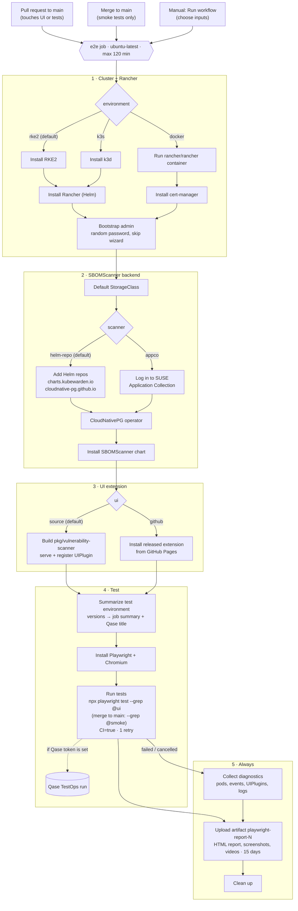
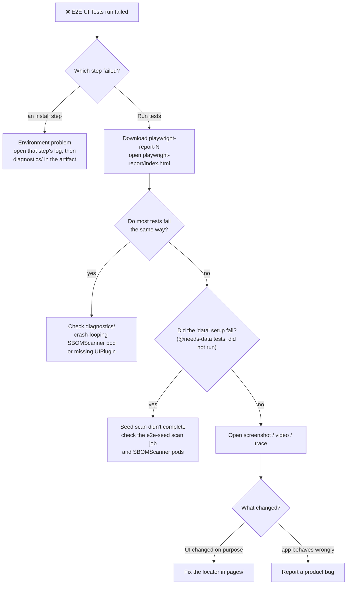

# Vulnerability Scanner UI tests

End-to-end (Playwright) tests for the **Vulnerability Scanner** Rancher UI extension (SBOMScanner),
plus the Jest unit tests for the extension code.

| Folder | What | Runner |
|---|---|---|
| [`e2e/`](e2e/) | Browser tests against a real Rancher with SBOMScanner installed | Playwright |
| [`unit/`](unit/) | Component and helper unit tests (config + mock data) | Jest, from the repo root: `yarn test:ci` |

The rest of this file is about the e2e suite.

## Contents

- [Quick start](#quick-start)
- [Running tests](#running-tests)
- [Architecture](#architecture)
- [Test coverage](#test-coverage)
- [Writing tests](#writing-tests)
- [Playwright agents (AI)](#playwright-agents-ai)
- [GitHub Actions](#github-actions)
- [Reports and Qase](#reports-and-qase)
- [Troubleshooting](#troubleshooting)

---

## Quick start

You need **Node.js 24+** and a Rancher instance with SBOMScanner and the Vulnerability Scanner
extension installed, reachable from your machine.

```bash
cd tests/e2e
npm ci
npx playwright install chromium

cp ../.env.example ../.env     # then edit ../.env (see below)

npx playwright test --grep @smoke    # one quick check per page
npx playwright show-report           # open the HTML report
```

Minimal `tests/.env` (it is gitignored; the config loads it from `tests/`, not `tests/e2e/`):

```bash
RANCHER_URL=https://<rancher-host>      # no trailing slash
TEST_USERNAME=admin
TEST_PASSWORD=<password>
TEST_RETRIES=0
SLOW_MO=0
QASE_MODE=off
```

Always run Playwright from `tests/e2e`. Login state and `uiversion.json` are written relative to the
current directory.

---

## Running tests

### Common commands

```bash
npx playwright test --grep @ui                         # full UI suite (what CI runs)
npx playwright test --grep @smoke                      # one "page loads" test per page
npx playwright test --project=chromium                 # everything except @needs-data (no seed, fast)
SEED_DATA=false npx playwright test                    # use the cluster's own data instead of seeding
npx playwright test tests/ui/images.spec.ts            # one page
npx playwright test -g "create form"                   # tests whose title matches

npx playwright test --ui                               # UI mode: watch, time-travel, pick locators
npx playwright test tests/ui/images.spec.ts --debug    # step through with the Inspector
npx playwright test --trace on                         # record traces, then:
npx playwright show-trace test-results/<test>/trace.zip

npx playwright test --list                             # list tests without running them
```

### Tags

Every test carries tags; select them with `--grep` / `--grep-invert`.

| Tag | Meaning |
|---|---|
| `@ui` | Read-only checks of page elements and their default state |
| `@smoke` | Subset of `@ui`: one "page loads" test per page |
| `@needs-data` | Needs a registry, a completed scan and scanned images. Runs in the `chromium-data` project, after `tests/data.setup.ts` seeds that data |
| `@functional` | (Phase 2, not written yet) changes cluster state: create, edit, delete, scan |

### Environment variables

| Variable | Default | Purpose |
|---|---|---|
| `RANCHER_URL` | — | Rancher base URL (`baseURL` for every `page.goto`) |
| `TEST_USERNAME` / `TEST_PASSWORD` | — | Rancher login, used by `tests/global.setup.ts` |
| `TEST_RETRIES` | `3` | Retries per failing test. Use `0` locally |
| `SLOW_MO` | `500` | Local slow-motion in ms. `0` = full speed (ignored when `CI` is set) |
| `SEED_DATA` | `true` | `false` skips `tests/data.setup.ts` and uses whatever data the cluster already has |
| `SEED_NAMESPACE` | `default` | Namespace of the seeded `e2e-seed` registry and its scan jobs. Use a user namespace - Rancher hides `cattle-*` namespaces by default |
| `CI` | unset | When set: headless, no slow-mo, 1600×900 viewport, video only on failure |
| `SHOW_CONSOLE_ERRORS` | `true` | Print captured browser console errors after each test |
| `ENV` | unset | Load `tests/.env.<ENV>` instead of `tests/.env`, e.g. `ENV=staging` |
| `QASE_MODE` | `off` | `testops` uploads results to Qase (see [Reports and Qase](#reports-and-qase)) |

### `run.sh`

`e2e/run.sh` is a local helper. It cleans old results, runs `--grep @ui`, copies the reports into
`_reports_/SBOMSCANNER_UITEST_<timestamp>/` and builds an HTML summary with `report_summary.sh`.
Before you use it, edit the placeholder sudo password and the `TEST_USERNAME`/`TEST_PASSWORD`
exports at the top. The exports override `.env`.

---

## Architecture

```
tests/
├── .env.example               # Template for tests/.env (gitignored)
├── README.md                  # This file
├── unit/                      # Jest unit tests
└── e2e/
    ├── playwright.config.ts   # Projects, testMatch, reporters, env handling
    ├── CLAUDE.md              # Test conventions (also read by Claude Code / the agents)
    ├── fixture/
    │   └── fixture.ts         # `test` with page objects as fixtures + console error capture
    ├── pages/                 # Page objects: the only place locators live
    │   ├── DashboardPage.ts
    │   ├── ImagesPage.ts
    │   ├── WorkloadsScanPage.ts
    │   ├── RegistriesPage.ts
    │   ├── VexManagementPage.ts
    │   ├── index.ts
    │   └── components/        # Shared Rancher widgets
    │       ├── SideNav.ts         # "Vulnerability Scanner" side menu group
    │       ├── SortableTable.ts   # Rancher tables: rows, column headers, empty state
    │       ├── ActionMenu.ts      # Row ⋮ menu (teleported to <body>)
    │       └── form.ts            # LabeledSelect / filter-row field helpers
    ├── tests/
    │   ├── global.setup.ts    # Logs in once, saves .auth/login-data.json, records uiversion.json
    │   ├── data.setup.ts      # Seeds a registry + completed scan for @needs-data tests (via Rancher API)
    │   ├── seed.spec.ts       # Starting point for the Playwright agents
    │   ├── ui/                # Phase 1: read-only UI checks, one spec per page
    │   └── functional/        # Phase 2 (planned): CRUD, scans, downloads
    ├── specs/ui/              # Markdown test plans (source for the generated specs)
    ├── .claude/agents/        # Playwright planner / generator / healer agent definitions
    ├── .mcp.json              # Playwright test MCP server used by the agents
    ├── run.sh, report_summary.sh
    └── package.json

Generated (gitignored): .auth/, test-results/, playwright-report/, jsonReports/, uiversion.json, .playwright-mcp/
```

### How a run fits together

```
setup                       chromium                     (every test except @needs-data)
global.setup.ts   ──┬──►    tests/**/*.spec.ts
  log in            │
  save login        └──►    data                  ──►    chromium-data   (@needs-data tests only)
  save uiversion.json       data.setup.ts                tests/**/*.spec.ts
                              registry "e2e-seed"
                              + one completed scan
```

Inside a test: spec ──► fixture ──► page object ──► Rancher UI (shared widgets in `components/`).

- **Projects.** `setup` logs in once. `chromium` runs everything except `@needs-data` and starts
  right after login. `data` creates the `e2e-seed` registry (public
  `ghcr.io/kubewarden/sbomscanner/test-assets/golang`, linux/amd64) and waits for one scan to
  complete, then `chromium-data` runs the `@needs-data` tests. Seeding uses Rancher's API, not
  the UI, and reuses an existing registry or completed scan, so reruns are fast. If seeding fails,
  the `@needs-data` tests show as "did not run" instead of failing one by one.
- **Fixture.** Specs import `test`/`expect` from `fixture/fixture.ts`, which provides
  `dashboardPage`, `imagesPage`, `workloadsScanPage`, `registriesPage`, `vexManagementPage` and
  `sideNav`. It also collects browser console errors and page exceptions for each test.
- **Page objects.** Each one exposes `url`, `goto()`, `expectLoaded()` and `readonly` `Locator`
  properties. Assertions live in specs, not in page objects.
- **Components.** Each Rancher widget that appears on several pages is modelled once and reused.

---

## Test coverage

All specs are in `e2e/tests/ui/`, tagged `@ui`, and only read from the cluster. Each one comes from
the plan of the same name in `e2e/specs/ui/`.

| Spec | Page | Covers |
|---|---|---|
| `navigation.spec.ts` | Side menu | Every "Vulnerability Scanner" entry opens the right URL and page (the only spec that clicks the menu) |
| `dashboard.spec.ts` | Dashboard | Empty state, or heading, registry filter, scanning stats (last scan, failed images, errors, total scanned) |
| `images.spec.ts` | Images | Search field and 5 filters defaulting to "Any", download buttons' enabled state, "Group by repository" unchecked, table columns, rows or empty state |
| `workloads-scan.spec.ts` | Advanced › Workloads Scan | Status badge, info banner, Enabled, resource location, artifacts namespace, authentication, CA bundle, scanning controls, namespace selectors, platform filter, Cancel/Save present |
| `registries.spec.ts` | Advanced › Registries configuration | List page: status panels, filters, bulk actions disabled without a selection, columns, row ⋮ menu. Create form: field defaults, Create disabled until filled, Cancel. Detail page: heading/badge, Start scan, info labels, recent scans |
| `vex-management.spec.ts` | Advanced › VEX Management | List page: bulk actions, filter, columns, status and URI per row, row ⋮ menu. Create form: empty fields, Enabled checked, Create disabled until filled, Cancel. Detail page: heading/badge, Enable/Disable button, info labels |

Detail-page checks open the first row, so they're tagged `@needs-data`.

To count tests per tag, run e.g. `npx playwright test --list --grep @needs-data`.

---

## Writing tests

The full rules are in [`e2e/CLAUDE.md`](e2e/CLAUDE.md). In short:

- **One spec per page** under `tests/ui/` (kebab-case, `*.spec.ts`). `test.describe` uses the page
  name shown in the UI and the tag: `test.describe('Images', { tag: '@ui' }, ...)`.
- **Titles are plain sentences**: `'shows the create form defaults and returns to the list on cancel'`.
- **One test per area, not per element.** Every test pays for a full Rancher page load (~8s), so each
  spec has one `@smoke` "page loads" test plus one test per area (list, row menu, create form, detail
  page). Inside, each check is a `test.step` using `expect.soft`, so the report still lists every
  failed element. Keep `@needs-data` checks in their own tests.
- **`@ui` tests are read-only.** Opening a form or menu and then Cancel/Escape is fine; Save,
  Delete, Start scan and Enable are not.
- **Don't depend on data.** Assert structure and default values, and accept either rows or
  `There are no rows to show.`. Tag anything that needs data with `@needs-data`. Never assert
  counts, dates or durations.
- **Locators** go in page objects. Prefer `getByRole` > `getByLabel`/`getByPlaceholder` >
  `getByTestId` > `getByText`. CSS is a last resort and needs a comment saying why.
- **Waiting.** Use web-first assertions (`await expect(...).toBeVisible()`). No `waitForTimeout`,
  no fixed delays.

### Example

```ts
// pages/DashboardPage.ts
export class DashboardPage {
  readonly url = '/dashboard/c/local/imageScanner/dashboard';
  readonly scanningStatsHeading: Locator;

  constructor(readonly page: Page) {
    const main = page.getByRole('main');
    this.scanningStatsHeading = main.getByRole('heading', { name: 'Scanning stats' });
  }

  async goto() { await this.page.goto(this.url); }
}
```

```ts
// tests/ui/dashboard.spec.ts
import { test, expect } from '../../fixture/fixture';

test.describe('Dashboard', { tag: '@ui' }, () => {
  test.beforeEach(async ({ dashboardPage }) => {
    await dashboardPage.goto();
    await dashboardPage.expectLoaded();
  });

  test('loads the dashboard or its empty state', { tag: '@smoke' }, async ({ dashboardPage }) => {
    await expect(dashboardPage.page).toHaveURL(/imageScanner\/dashboard/);
  });

  // One page load, one step per area; soft assertions report every missing element, not just the first.
  test('shows the header, registry filter and scanning stats', { tag: '@needs-data' }, async ({ dashboardPage }) => {
    await test.step('scanning stats', async () => {
      await expect.soft(dashboardPage.scanningStatsHeading).toBeVisible();
      // ...
    });
  });
});
```

To add a new page: create `pages/<Name>Page.ts`, export it from `pages/index.ts`, add a fixture in
`fixture/fixture.ts`, then write `tests/ui/<name>.spec.ts`.

---

## Playwright agents (AI)

The suite was generated, and is maintained, with Playwright's test agents
(`npx playwright init-agents --loop=claude`). They need a Rancher instance they can reach.

| Agent | Use it to | Output |
|---|---|---|
| `playwright-test-planner` | Explore a page in a live browser and write scenarios | `specs/ui/<page>.md` |
| `playwright-test-generator` | Turn a plan into a spec, checking each locator against the live UI | `tests/ui/<page>.spec.ts` + page object |
| `playwright-test-healer` | Run failing tests, inspect the page, fix locators/waits | Edits under `pages/` and `tests/` |

**Setup.** Start Claude Code **in `tests/e2e`** (open that folder in VS Code, or `cd tests/e2e && claude`),
so it picks up `.claude/agents/`, `.mcp.json` and `CLAUDE.md`. Approve the `playwright-test` MCP server
when prompted, and check with `/mcp` and `/agents`. Set `SLOW_MO=0` and `TEST_RETRIES=0` in `.env`
so the agents run at full speed.

**Example prompts:**

```
Use the playwright-test-healer to fix tests/ui/registries.spec.ts. Fix locators in pages/, not in the
spec. Do not weaken assertions or add test.fixme without explaining why — if the app looks broken, report it.
```

```
Use the playwright-test-planner to explore <page> and write specs/ui/<page>.md (only @ui scenarios).
Then use the playwright-test-generator to implement it as tests/ui/<page>.spec.ts following CLAUDE.md.
```

Review the agents' changes with `git diff`. Watch for weakened assertions, `test.fixme`, and locators
written inline in a spec.

You can also record steps by hand, without AI:
`npx playwright codegen --ignore-https-errors --load-storage=.auth/login-data.json $RANCHER_URL`.

---

## GitHub Actions

Workflow: [`.github/workflows/e2e-ui.yml`](../.github/workflows/e2e-ui.yml) (**E2E UI Tests**).
Each run builds a throwaway cluster on the runner, installs Rancher, SBOMScanner and the extension,
then runs `npx playwright test --grep @ui` (only the `@smoke` tests after a merge to `main`).

### Triggers

| Trigger | When | Notes |
|---|---|---|
| `pull_request` | PRs to `main` that touch `pkg/vulnerability-scanner/**`, `package.json`, `yarn.lock`, `tests/e2e/**` or the workflow | UI built from the PR source |
| `push` | Merges to `main` that touch the same paths | **Smoke tests only** (`--project=chromium --grep @smoke`, no data seed), UI built from the merged `main` |
| `workflow_dispatch` | Manual | All inputs below |

### Manual run inputs

| Input | Default | Options |
|---|---|---|
| `environment` | `rke2` | `rke2` (RKE2 + Rancher Helm chart), `k3s` (k3d + Helm chart), `docker` (`rancher/rancher` container) |
| `rancher` | `p*` | Version constraint: `p2.14`, `c2.13`, `p*` (latest Prime), `p2.15-0` (devel) |
| `k8s` | derived | Kubernetes minor for rke2/k3s, e.g. `v1.33`. Empty = the newest minor the Rancher version supports. A value outside the supported range runs with a warning |
| `ui` | `source` | `source` (build `pkg/vulnerability-scanner` from the checkout), `github` (released chart) |
| `scanner` | `helm-repo` | `helm-repo` (Helm repos charts.kubewarden.io and cloudnative-pg.github.io), `appco` (SUSE Application Collection, needs secrets) |
| `sbomscanner` | latest | SBOMScanner chart version |

From the CLI:

```bash
gh workflow run e2e-ui.yml --ref <branch> \
  -f environment=k3s -f rancher='p2.14' -f ui=source -f scanner=helm-repo
gh run watch
```

### Pipeline



1. **Cluster and Rancher.** Install RKE2, k3d, or Rancher in Docker using the shared
   [kubewarden e2e scripts](https://github.com/kubewarden/kubewarden-end-to-end-tests). The Kubernetes
   minor comes from the support matrix table in their `rancher.sh`. RKE2 is installed as the newest
   published patch of that minor, looked up from GitHub releases, so `update.rke2.io` isn't needed.
   Then bootstrap the admin user with a random password and skip the first-login wizard.
2. **SBOMScanner backend.** Default StorageClass, CloudNativePG, then the SBOMScanner chart (1 replica each).
   The default `helm-repo` source downloads the Trivy DB from `mirror.gcr.io`, because `public.ecr.aws`
   rate-limits GitHub runners.
3. **Extension.** Build from source and register it as a `UIPlugin` served from `127.0.0.1:4500`,
   or install the released chart.
4. **Summarize test environment.** Read the installed versions back from the cluster and use them for
   the Qase run title, description and tags, and for the job summary.
5. **Playwright.** `npm ci`, install Chromium, run `--grep @ui` (after a merge to `main`: `--project=chromium --grep @smoke`) with `CI=true` and `TEST_RETRIES=1`.
6. **On failure.** Collect pods, events, UIPlugins, Rancher logs and SBOMScanner logs into `diagnostics/`.
7. **Always.** Upload the `playwright-report-<attempt>` artifact (HTML report, `test-results/`,
   `uiversion.json`, `diagnostics/`, kept 15 days), then clean up.

CI provides `RANCHER_URL`, `TEST_USERNAME` and `TEST_PASSWORD` itself, so no `.env` is needed.

### Secrets and variables

| Name | Kind | Required for |
|---|---|---|
| `QASE_TESTOPS_API_TOKEN` | secret | Uploading to Qase (skipped when unset and on PRs from forks, which get no secrets; the run shows a "Qase upload skipped" notice) |
| `QASE_TESTOPS_PROJECT` | variable | Qase project code (e.g. `SS`). Use a variable, not a secret: a secret is masked everywhere in logs (`PA***WORD`), and the job summary can't link to the Qase run |
| `DOCKERHUB_USERNAME` / `DOCKERHUB_PASSWORD` | secret | Avoid Docker Hub rate limits during the Helm install (optional) |
| `APPCO_USERNAME` / `APPCO_PASSWORD` | secret | `scanner=appco` only |

### Reading a failed run



1. Open the job summary to see which Rancher, Kubernetes, extension and SBOMScanner versions were tested.
2. Download the `playwright-report-*` artifact and open `playwright-report/index.html`. Failed tests
   include a screenshot, a video, and a trace on retry.
3. If many tests fail the same way, look at `diagnostics/` first. A crash-looping SBOMScanner pod or a
   missing `UIPlugin` makes every page fail.

---

## Reports and Qase

The config always writes three reports:

- `dot`: console progress.
- `playwright-report/`: HTML, open it with `npx playwright show-report`.
- `jsonReports/jsonReport.json`: machine-readable.

With `QASE_MODE=testops`, results also go to Qase TestOps. Configure it with:

- `QASE_TESTOPS_API_TOKEN` (secret) and `QASE_TESTOPS_PROJECT` (variable);
- optionally `QASE_RUN_ID`, to report into an existing run;
- `QASE_RUN_TITLE`, `QASE_RUN_DESCRIPTION`, `QASE_RUN_TAGS`. CI fills these in, and locally the title
  defaults to `SBOM Scanner UI Test - v<ui version> - <date>`.

Qase matches cases by **test title**, so renaming a test creates a new case. Once a title is stable,
link it to a fixed case with `qase(<id>, '<title>')` from `playwright-qase-reporter`.

---

## Troubleshooting

| Symptom | Likely cause / fix |
|---|---|
| `TEST_USERNAME and TEST_PASSWORD environment variables must be set` | `.env` is missing or in the wrong folder. It belongs in `tests/.env` |
| Setup times out waiting for `**/dashboard/home` | Wrong URL or password. Rancher may also still be starting, or the first-login wizard may not be done |
| `data` setup fails or times out, `@needs-data` tests "did not run" | The scan didn't complete: check the `e2e-seed` scan job and SBOMScanner pods (`kubectl get scanjobs -n default`, `kubectl get pods -n cattle-sbomscanner-system`). Use `SEED_DATA=false` to run against existing data |
| Console shows `Unknown schema for type: storage.sbomscanner.kubewarden.io...` | The SBOMScanner storage API service is unavailable. Check the storage pod, not the tests |
| Locator not found after a UI change | Run the test with `--ui` or `--debug`, or ask the healer agent. Fix it in `pages/`, not in the spec |
| Tests very slow locally | Set `SLOW_MO=0` and `TEST_RETRIES=0` |
| `.auth/` or `uiversion.json` appear in the wrong folder | Playwright was run from outside `tests/e2e` |
| Passes locally, fails in CI | CI runs headless at 1600×900 on a fresh cluster. Reproduce with `CI=1 npx playwright test ...` |
